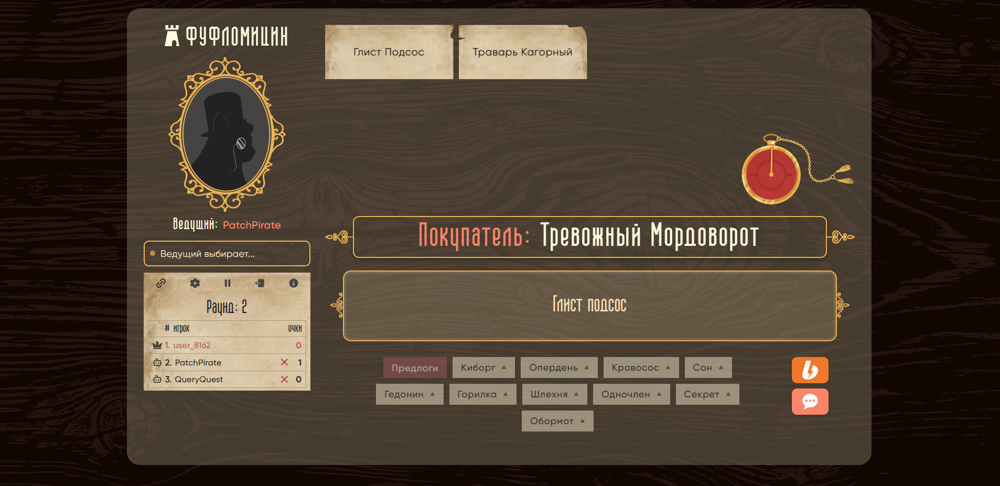
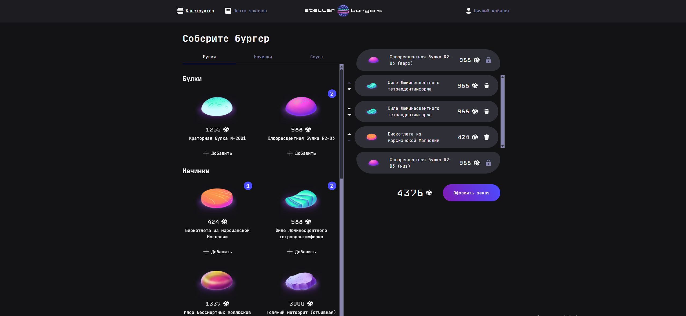
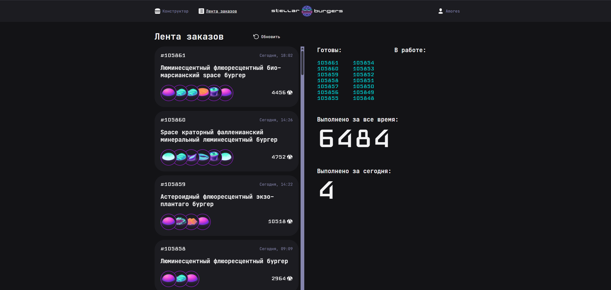
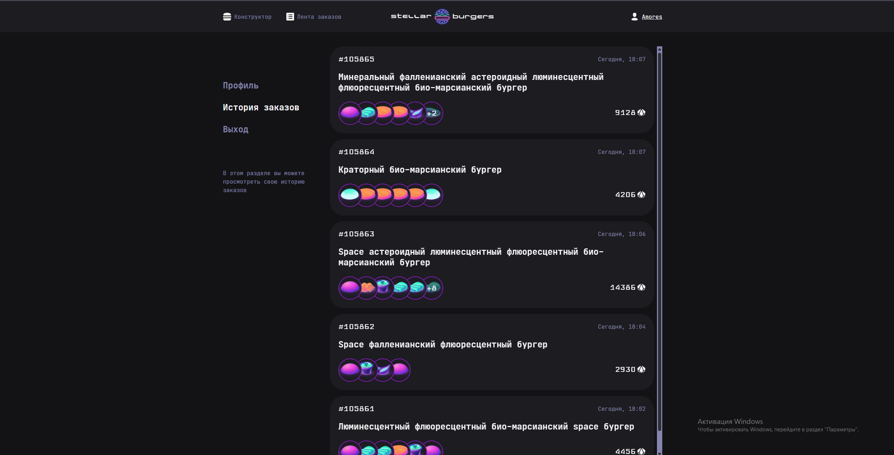
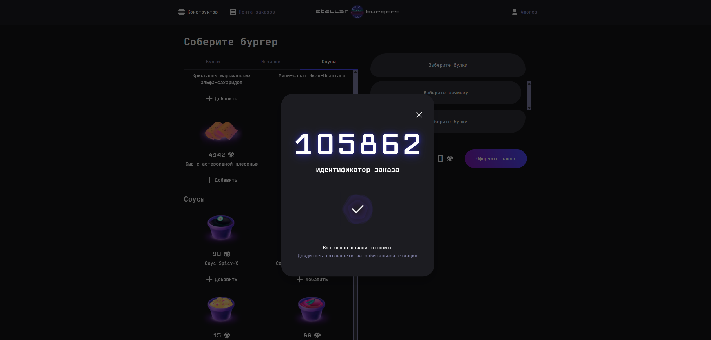
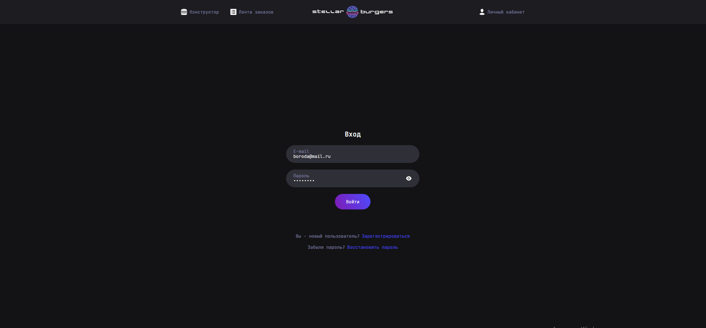
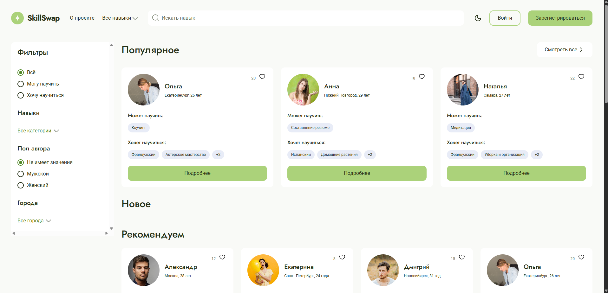
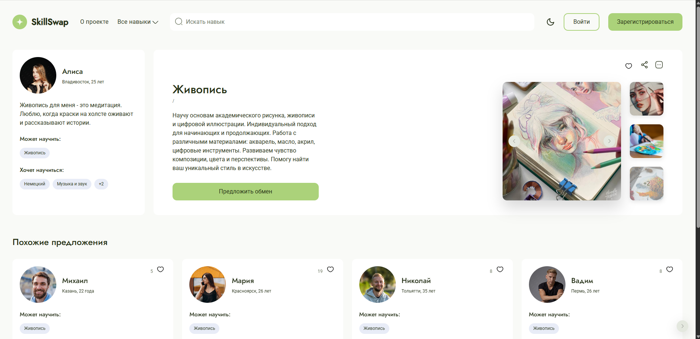

# Никита — Frontend-разработчик

Telegram: [@ElmErroom](https://t.me/ElmErroom) · GitHub: [elmerroom](https://github.com/elmerroom)

Открыт к предложениям (удалённо/гибрид/офис).

[📄 Скачать резюме (PDF)](./Проскурин_Никита_Frontend.pdf)

## Избранные проекты

### 🎲 TowerEmpire — multiplayer-платформа настольных игр
[Репозиторий](https://github.com/elmerroom/TowerEmpire_Frontend) · [Сайт](https://tower-empire.org/)

Ещё скриншоты

Real-time игра с лобби, чатом и синхронизацией состояния через WebSocket.
Работаю над проектом в команде разработчиков.

**Мой вклад:**
- Синхронизация состояния лобби и игрового стола между игроками в реальном времени
- Переработал архитектуру Layout-компонентов: разделил декоративную логику и контент — убрал дублирование, упростил добавление страниц
- Исправил системные баги на стыке роутинга и состояния при переключении лобби / комнат / главной
- Закрыл уязвимость в модели ролей: запрет передачи прав хоста боту
- Работа в Git-процессе команды: ветки, код-ревью, разрешение конфликтов

`React` `TypeScript` `Redux Toolkit` `WebSocket` `SCSS`

### 🍔 Stellar Burgers — заказ готовой еды
[Репозиторий](https://github.com/elmerroom/stellar-burgers)

Ещё скриншоты

**Мой вклад:**
Самостоятельный проект по заказу готовой еды: спроектировал бизнес-логику и реализовал взаимодействие с бэкендом.

- Настроил регистрацию и авторизацию: формы с валидацией, обработка ошибок API, сохранение сессии
- Реализовал защищённые роуты: разграничение доступа к разделам в зависимости от статуса авторизации
- Добавил модальные окна для ключевых сценариев (оформление заказа, детали ингредиента)
- Покрыл бизнес-логику unit- и интеграционными тестами

`React` `TypeScript` `Redux Toolkit` `Jest` `Cypress` `REST`

### 🤝 SkillSwap — поиск наставников и учеников
[Репозиторий](https://github.com/elmerroom/SkillSwap)

Ещё скриншоты

Сайт по поиску наставников и учеников по навыкам. Командный проект. Реализовал клиентское хранилище на IndexedDB, кастомные хуки для работы с изображениями, слайдер галереи (Splide), проработал доступность интерфейса.

`React` `TypeScript` `IndexedDB` `Splide`

---

## Стек

- **Языки:** JavaScript, TypeScript, HTML, CSS
- **Фреймворки и UI:** React, React Router, Redux Toolkit, SCSS/SASS
- **Real-time и данные:** WebSocket, REST, IndexedDB
- **Тесты:** Jest, Cypress
- **Инструменты:** Git, Webpack, Vite, ESLint, Prettier, Stylelint
- **Подходы:** БЭМ, Feature-Sliced Design, Agile (Scrum)

## Сейчас изучаю:
Node.js, Next.js

## AI-assisted development
Cursor; промпт-инжиниринг (few-shot, chain-of-thought); ревью AI-кода; unit-тесты как контракт для генерации; изоляция чувствительных данных.
